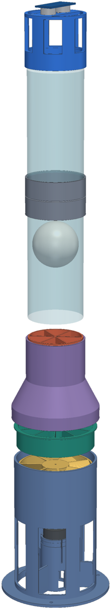
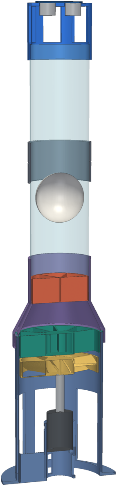
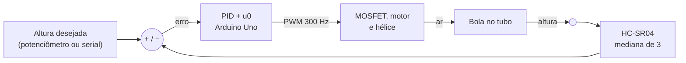
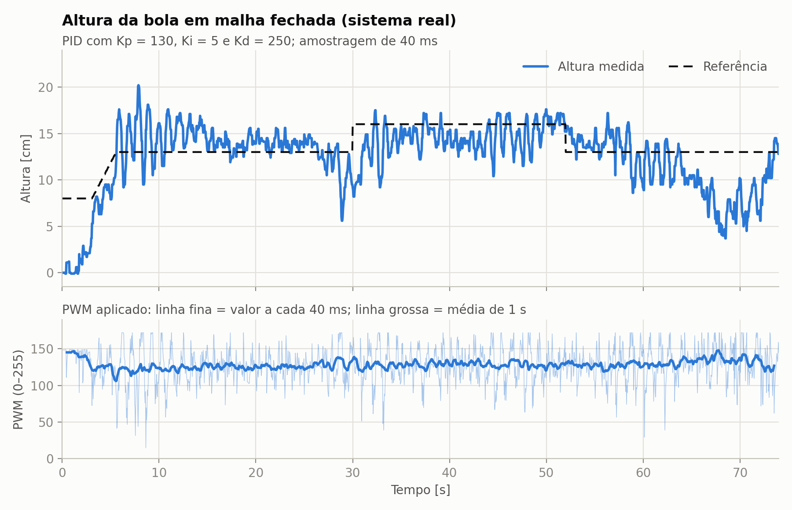

# Levitador pneumático com controle PID

Uma bola flutua dentro de um tubo vertical, sustentada pelo ar de uma hélice. Um sensor ultrassônico mede a altura da bola e um Arduino Uno ajusta a força do motor a cada 40 ms para mantê-la na altura escolhida.

O repositório reúne o firmware, os dados dos ensaios, a modelagem em MATLAB/Simulink e as peças impressas em 3D.

  
  &nbsp;&nbsp;&nbsp;&nbsp;
  

> Os desenhos do conjunto mostram uma hélice de pressão, testada e depois abandonada. A montagem final usa uma [hélice de cinco pás](docs/img/07_helice_usada.png).

## Como funciona

Com força constante no motor, a bola não tem ponto de repouso: um pouco mais de ar a leva ao topo e um pouco menos a derruba. Por isso o sistema precisa de malha fechada.

## Resultado

No ensaio final, o controle ficou ligado por 74 s. A bola decolou sozinha em 3,1 s, passou pelas referências de 13, 16 e 13 cm e não voltou a tocar o fundo.

| Referência | Erro médio | Altura nos últimos 10 s |
|:--|--:|--:|
| 13 cm | +0,9 cm | 13,1 ± 1,8 cm |
| 16 cm | −1,6 cm | 15,0 ± 1,7 cm |
| 13 cm (fim) | −2,0 cm | 8,5 ± 2,4 cm |

A bola balança cerca de 2 cm para cada lado, e no último trecho perdeu altura. A discussão está em [Sintonia e resultados](docs/sintonia-e-resultados.md).

## Parâmetros finais

| Parâmetro | Valor |
|:--|:--|
| Kp / Ki / Kd | 130 / 5 / 250 (altura em metros, PWM de 0 a 255) |
| PWM de equilíbrio `u0` | 127 |
| Limite de PWM no ar | 172 (`u0` + 45) |
| Período de amostragem | 40 ms |
| Filtro da derivada | 25 rad/s |
| Frequência do PWM | 300 Hz |
| Faixa de altura recomendada | 13 a 17 cm |

## Começando

1. Imprima as peças e monte o circuito: [Montagem](docs/montagem.md).
2. Abra `firmware/pid_levitador_uno/pid_levitador_uno.ino` na Arduino IDE, escolha **Arduino Uno** e grave. Não é preciso instalar bibliotecas.
3. Abra o Monitor Serial em **115200** baud, com final de linha.
4. Com a bola parada no fundo, envie `z` para zerar a altura.
5. Envie `r 14` para pedir 14 cm e `a` para ligar o PID. Para desligar o motor, envie `s`.

Todos os comandos estão em [Firmware](docs/firmware.md).

> [!WARNING]
> O motor liga nos modos automático (`a`) e manual (`m`). Mantenha as mãos e fios longe da hélice e tenha um jeito rápido de desligar a bateria. O comando `m` não aplica o limite de PWM do modo automático: com a bateria de 16 V e o motor de 12 V, não passe de `m 180`.

## Estrutura do repositório

| Pasta | Conteúdo |
|:--|:--|
| [`firmware/`](firmware) | Programas do Arduino Uno e versões antigas para ESP32-C3 |
| [`ensaios/`](ensaios) | Scripts de ensaio, dados brutos, identificação e gráficos |
| [`simulink/`](simulink) | Modelo no Simulink e análises em MATLAB |
| [`modelos_3d/`](modelos_3d) | Peças em STL e os arquivos que as geram |
| [`docs/`](docs) | Documentação e imagens |

## Documentação

- [Montagem](docs/montagem.md): peças, circuito e ajustes mecânicos.
- [Firmware](docs/firmware.md): controle, proteções e comandos.
- [Modelagem](docs/modelagem.md): equações, função de transferência e Simulink.
- [Sintonia e resultados](docs/sintonia-e-resultados.md): ensaios, ganhos e limitações.
- [Ensaios e análise](docs/ensaios.md): como repetir as medições e gerar os gráficos.

## Contexto

Projeto acadêmico da disciplina de controle.
