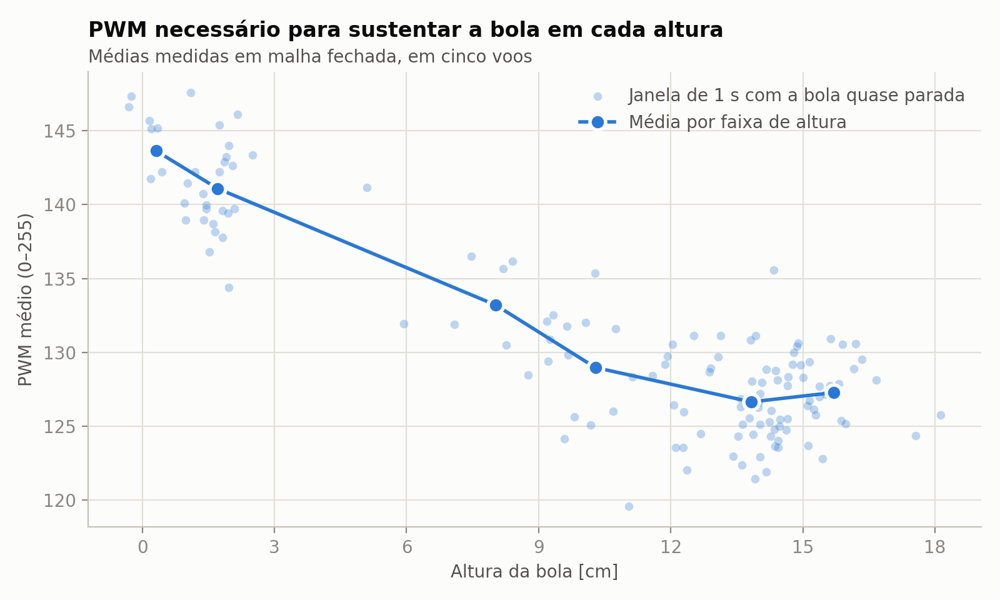
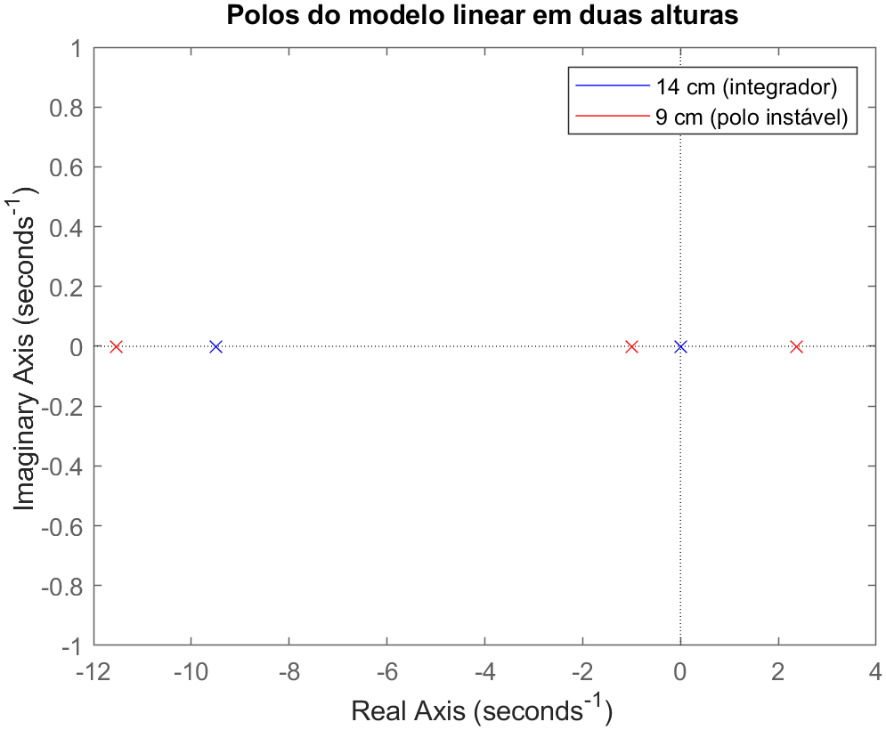
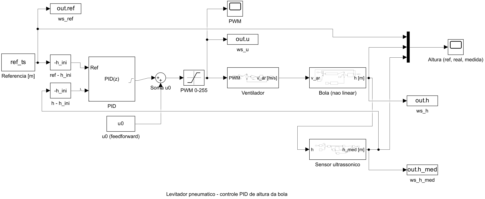
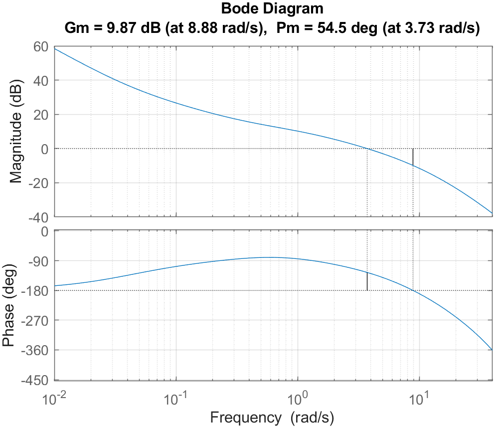

# Modelagem

## Equações

Duas forças agem sobre a bola: o peso e o arrasto do ar, que cresce com o quadrado da velocidade relativa.

$$m\,\ddot h = c\,(v-\dot h)^2 - m\,g$$

O ventilador demora a responder e é representado por um sistema de primeira ordem:

$$\tau\,\dot v + v = K_v\,u$$

Linearizando em torno do equilíbrio, com $a = 2g/v_0$:

$$G(s)=\frac{H(s)}{U(s)}=\frac{K_v\,a}{s\,(s+a)\,(\tau s+1)}$$

O $s$ isolado no denominador é um integrador: qualquer diferença constante de força faz a bola subir ou descer sem parar.

## PWM de equilíbrio por altura



| Altura (cm) | −2 a 1 | 1 a 3 | 6 a 9 | 9 a 12 | 12 a 15 | 15 a 18 |
|:--|--:|--:|--:|--:|--:|--:|
| PWM médio | 143,6 | 141,1 | 133,2 | 129,0 | 126,7 | 127,3 |
| Desvio padrão | 2,7 | 3,1 | 3,1 | 3,7 | 2,9 | 2,2 |

A partir de 12 cm, o PWM quase não muda. Perto do fundo, a bola exige mais ar quanto mais desce, o que torna a região instável. Por isso o controle trabalha entre 13 e 17 cm.

## Valores identificados

Os parâmetros vieram de voos controlados, por máxima verossimilhança. O ajuste não apontou um único resultado:

| Candidato | $K_v$ (m/s por PWM) | $\tau$ (s) | Ganho crítico teórico $K_u$ |
|:--|--:|--:|--:|
| 1 (adotado) | 0,0163 | 1,00 | 644 |
| 2 | 0,0063 | 0,56 | 4183 |

O segundo se ajustou um pouco melhor aos dados, mas prevê uma bola lenta demais para os disparos observados. Com o primeiro, a 14 cm:

$$G(s)=\frac{0{,}1548}{s\,(s+1)\,(s+9{,}496)}$$

Os polos ficam em 0, −1 e −9,5. A 9 cm aparece um polo positivo, em +2,4.



## Simulink

O modelo usa as equações não lineares, a curva de PWM medida e as limitações do programa real: amostragem de 40 ms, resolução e ruído do sensor, mediana de três e limite de PWM.



### Arquivos

| Arquivo | Função |
|:--|:--|
| `parametros_levitador.m` | Parâmetros, com a origem de cada valor |
| `criar_modelo_levitador.m` | Gera o `levitador_bola.slx` |
| `analise_levitador.m` | Gera todas as figuras da análise |
| `comparar_candidatos.m` | Compara os dois candidatos com o voo real |
| `ler_ensaio.m` | Lê os dados de `ensaios/dados` |

### Como rodar

O modelo foi feito no MATLAB R2023b, com Simulink e Control System Toolbox.

```matlab
cd simulink
analise_levitador      % figuras e comparacao com o voo real
comparar_candidatos    % compara os dois pares de (Kv, tau)
```

## Estabilidade em malha fechada

Com os ganhos finais, o filtro e um atraso de 60 ms na medição, o modelo linear tem margem de fase de 54,5° e margem de ganho de 9,9 dB.


