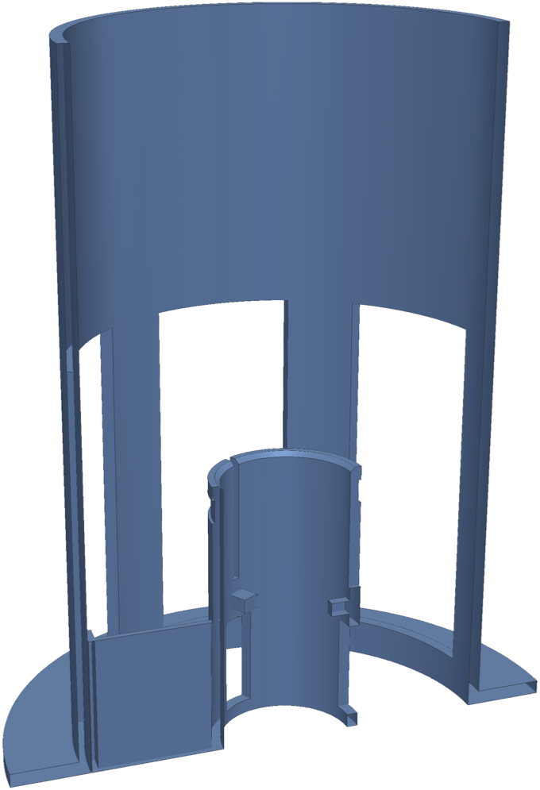
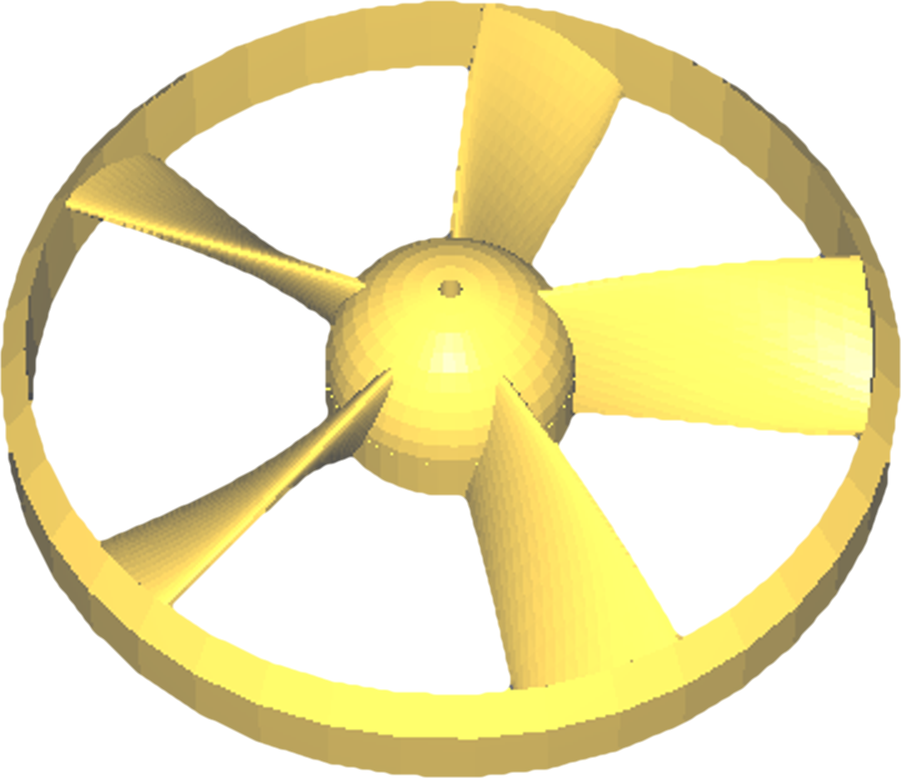
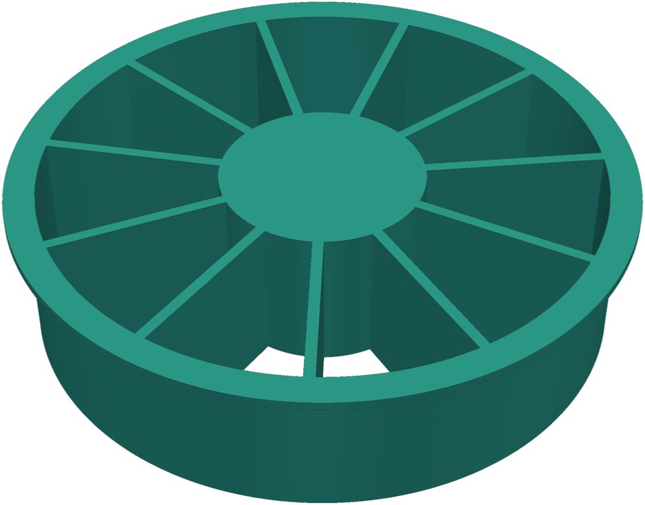
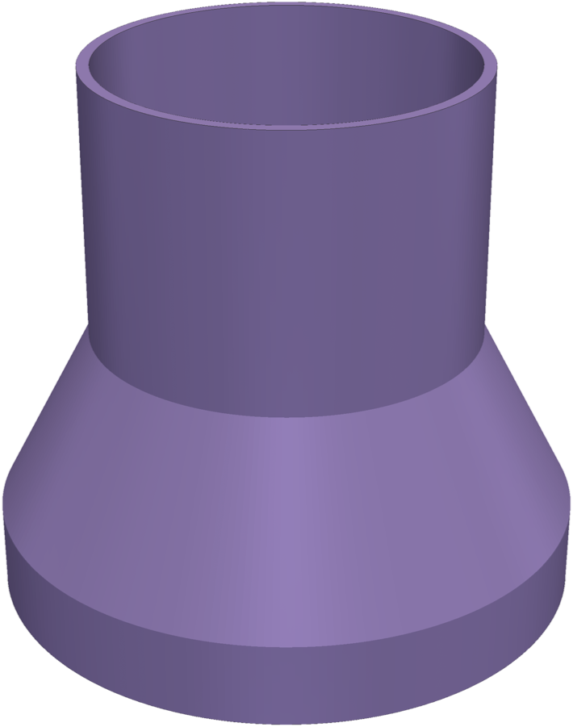
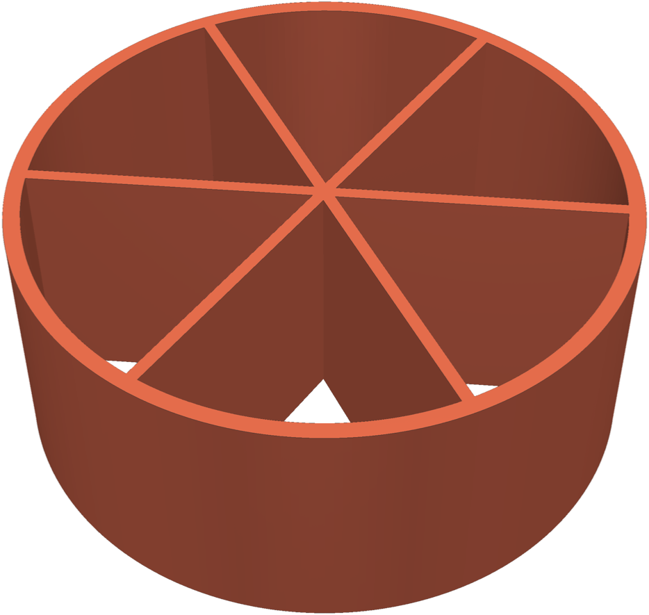
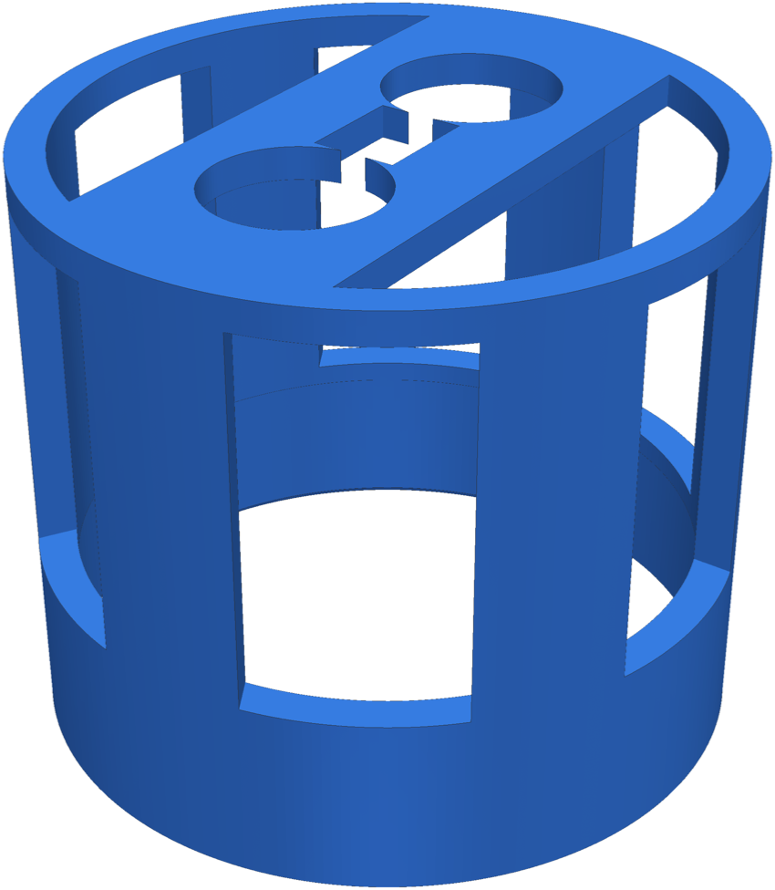

# Montagem

## Lista de materiais

| Item | Observação |
|:--|:--|
| Arduino Uno | Alimentado pela USB |
| HC-SR04 | Sensor ultrassônico, no topo do tubo |
| MOSFET IRLZ44N | Nível lógico, aciona bem com 5 V |
| Motor CC com escovas, 12 V | Tipo microrretífica, corpo de 27,3 mm |
| Bateria de lítio de 16 V | Alimenta apenas o motor |
| Diodo de roda livre | Em paralelo com o motor |
| Resistor de 100 a 220 Ω | Em série com o gate |
| Resistor de 10 kΩ | Do gate para o GND |
| Potenciômetro | Ajusta a altura desejada (opcional) |
| Garrafas PET de 500 mL | Corpo cilíndrico, 59,4 mm por dentro |
| Peças em PLA | Pasta [`modelos_3d/`](../modelos_3d) |

## Ligações

| Componente | Ligação |
|:--|:--|
| Potenciômetro | Cursor no A0, extremos em 5 V e GND |
| MOSFET, gate | D9, com resistor em série e 10 kΩ para o GND |
| MOSFET, dreno | Negativo do motor |
| MOSFET, source | GND |
| Motor, positivo | Positivo da bateria |
| Diodo | Catodo no positivo do motor, anodo no dreno |
| HC-SR04 | VCC em 5 V, GND, TRIG no D6 e ECHO no D7 |
| GND | Comum entre o Arduino e a bateria |

O PWM usa o Timer1, por isso o gate precisa ficar no pino 9.

## Peças, de baixo para cima

| Peça | Função |
|:--|:--|
| Base com janelas | Deixa o ar entrar e sustenta o conjunto |
| Abraçadeira do motor | Pinça que centraliza o motor |
| Hélice de cinco pás, com aro | Sopra o ar |
| Estator de 11 aletas | Tira o giro do ar |
| Funil | Estreita a passagem até o diâmetro do tubo |
| Retificador de 6 aletas | Organiza o fluxo e impede a bola de cair na hélice |
| Tubo PET | Guia a bola |
| Bola oca | Duas metades coladas, 49,5 mm e parede de 0,45 mm no projeto |
| Suporte do sensor | Segura o HC-SR04 e deixa o ar sair |

| Base | Hélice usada | Estator |
|:--:|:--:|:--:|
|  |  |  |
| **Funil** | **Retificador** | **Suporte do sensor** |
|  |  |  |

### Arquivos de impressão

| Arquivo | Peça |
|:--|:--|
| `tubo/base_motor_duto_parteA.stl` | Base e duto da hélice |
| `tubo/miolo_motor_reposicao.stl` | Abraçadeira do motor |
| `tubo/funil_parteB1.stl` | Funil |
| `tubo/retificador_parteB2.stl` | Retificador |
| `tubo/funil_retificador_parteB.stl` | Versão anterior, com funil e retificador em uma peça só |
| `tubo/luva_juncao_furo60_4mm.stl` | Luva que une duas garrafas |
| `tubo/anel_teste_furo60_*.stl` | Anéis para testar a folga antes de imprimir a luva |
| `tubo/suporte_hcsr04_impressao.stl` | Suporte do sensor |
| `bola/meia_esfera_D*.stl` | Metade da bola, em três diâmetros |

Os arquivos `.scad` abrem no OpenSCAD, e os `.py` usam a biblioteca `manifold3d`:

```bash
pip install numpy manifold3d
python modelos_3d/tubo/gerar_base_motor.py .
```

Os modelos 3D da hélice de cinco pás e do estator não estão no repositório.

## A conta da bola

Para flutuar, a pressão do ar multiplicada pela área da bola precisa igualar o peso. Em uma casca fina de espessura $e$ e densidade $\rho$:

$$\Delta P \approx \frac{\rho\,(\pi D^2 e)\,g}{\pi D^2/4} = 4\,\rho\,e\,g$$

O diâmetro desaparece, e a pressão depende só da espessura da parede. Com PLA (cerca de 1240 kg/m³) e 0,45 mm, o resultado fica próximo de 22 Pa. O tamanho da bola pôde então ser escolhido pela folga no tubo.

## O que precisou mudar no caminho

1. **O ar voltava por baixo.** Com o funil, o ar saía pelas janelas da base e a bola não se mexia. Reduzir a folga e trocar a hélice não bastou. O estator resolveu, até com a hélice antiga. A explicação provável é o giro do ar, que não foi medido.
2. **A hélice.** Uma versão de 84 mm raspava no duto, por causa da folga do eixo, e o diâmetro foi reduzido. A hélice de pressão, de pás largas, não ficou bem centralizada, e a de cinco pás foi a que funcionou.
3. **O suporte do sensor bloqueava a saída.** Com o topo aberto, a área de saída passou de 115% para 184% da área do tubo.
4. **A bateria de 12 V não dava conta.** Mesmo com o motor no máximo, a bola tinha dificuldade para subir. A bateria de lítio de 16 V resolveu, e o firmware limita a tensão média no motor a cerca de 10,8 V durante o voo.
5. **O MOSFET esquentava.** O ESP32-C3 usado no início tem saída de 3,3 V. Baixar o PWM de 20 kHz para 300 Hz ajudou muito, e depois o projeto migrou para o Arduino Uno, de 5 V.
6. **O sensor se confundia no tubo comprido.** O eco provavelmente vinha das paredes, e o tubo foi encurtado.
