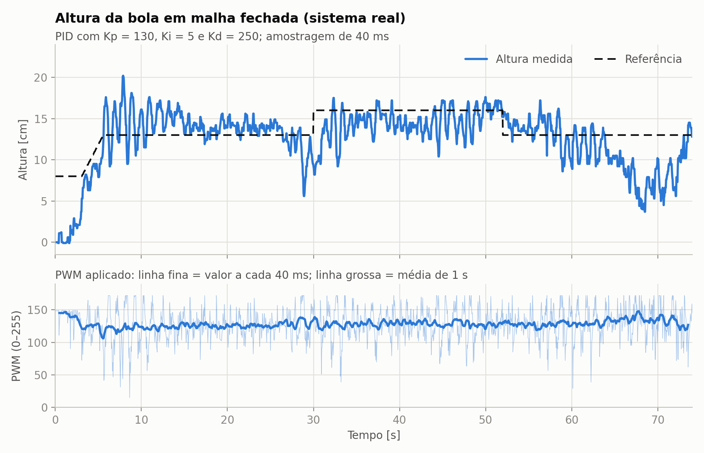
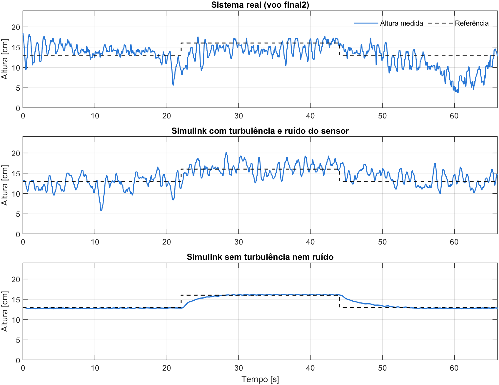

# Sintonia e resultados

## Por que não Ziegler-Nichols

O primeiro método precisa de uma resposta ao degrau que se estabilize, e isso não acontece em um sistema com integrador. O segundo precisa de uma oscilação constante só com a ação proporcional, e ela não apareceu na bancada: com Kp = 20 a bola ficou perto do fundo, e com 40 e 80 disparou para o topo. O cálculo teórico também não ajudou, porque o ganho crítico varia mais de seis vezes entre os dois modelos possíveis.

Os ganhos foram ajustados por experimentos.

## Ensaios

| Kp / Ki / Kd | `u0` | Limite | O que aconteceu |
|:--|--:|--:|:--|
| Sem PID | | | A bola saiu do fundo entre 146 e 148 de PWM |
| 20 / 0 / 0 | 146 | 255 | Ficou entre 0 e 4 cm |
| 40 / 0 / 0 | 146 | 255 | Disparou para o topo |
| 80 / 0 / 0 | 144 | 255 | Disparou |
| 60 / 15 / 25 | 144 | 255 | Subiu até uns 5 cm e disparou |
| 130 / 40 / 100 | 146 | 255 | Disparou, mesmo com o PWM caindo de 162 para 74 |
| 90 / 10 / 40 | 146 | 150 | Disparou |
| 110 / 5 / 150 | 140 | 149 | Disparou |
| 130 / 5 / 250 | 138 | 149 | Voou 25 s, perto de 13 cm em vez de 8 |
| 130 / 5 / 250 | 127 no ar | 149 | 10,0 ± 1,3 cm para uma referência de 10 cm |
| 130 / 20 / 250 | 127 no ar | 149 | Acertou 14 cm, mas caiu na referência de 10 |

## O que os ensaios ensinaram

1. **O vento demora a diminuir.** O controlador precisa frear antes que a bola ganhe velocidade, e quem faz isso é a ação derivativa. O disparo só parou com Kd = 250 e um limite de PWM.
2. **Decolar e flutuar são situações diferentes.** A bola precisa de cerca de 147 de PWM para sair do fundo e de 127 para se manter no ar.
3. **Um limite baixo demais atrapalha**, porque corta as correções para cima e deixa passar as correções para baixo. No ar, ele subiu para 172.
4. **A integral precisa ser suave.** Com Ki = 20, a bola terminou caindo.

## Ensaio final

| Referência | Duração | Erro médio | Altura nos últimos 10 s |
|:--|--:|--:|--:|
| 13 cm | 24,4 s | +0,9 cm | 13,1 ± 1,8 cm |
| 16 cm | 22,0 s | −1,6 cm | 15,0 ± 1,7 cm |
| 13 cm (fim) | 22,0 s | −2,0 cm | 8,5 ± 2,4 cm |

## Sistema real e simulação

| Trecho | Real | Simulação |
|:--|--:|--:|
| 13 cm | 13,3 ± 1,7 cm | 12,5 ± 2,1 cm |
| 16 cm | 14,8 ± 1,5 cm | 16,3 ± 1,6 cm |
| 13 cm (fim) | 9,5 ± 2,7 cm | 13,2 ± 1,7 cm |

A simulação acompanha os dois primeiros trechos e não explica a queda do último.

## Limitações

- A bola balança cerca de 2 cm. Parte vem da turbulência e parte do ruído do sensor, que a ação derivativa amplifica.
- A queda no fim do voo pode ter relação com a bateria ou com o aquecimento do motor e do MOSFET. A causa não foi comprovada: o PWM de equilíbrio subiu cerca de 4 por minuto nesse voo, com incerteza de 3, e outros dois voos não repetiram o comportamento.
- Os parâmetros do ventilador são uma estimativa, com dois candidatos possíveis.
- A versão com compensação da bateria não foi testada no sistema real.
